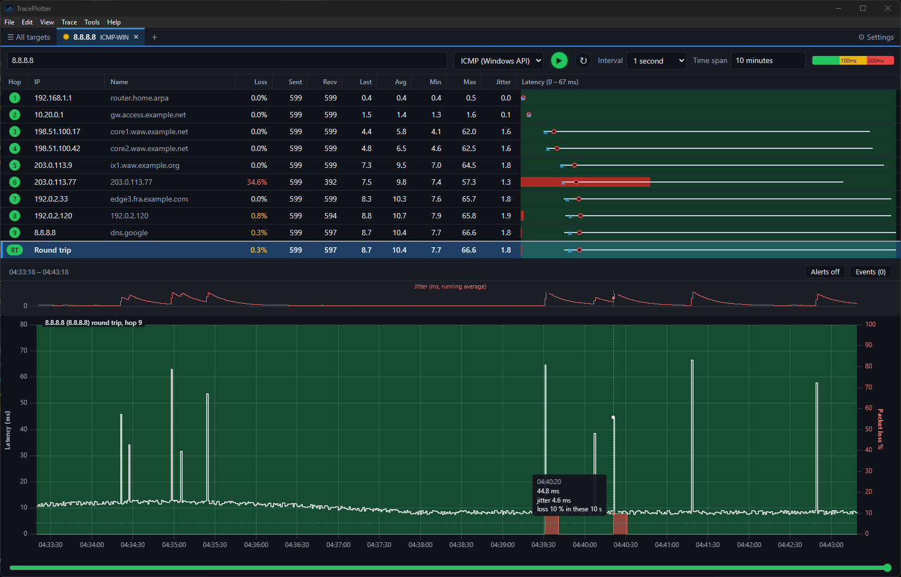

<div align="center">


# TracePlotter

[](https://github.com/knot2006/TracePlotter/releases/latest)
[](https://github.com/knot2006/TracePlotter/actions/workflows/ci.yml)
[](LICENSE)


Continuous traceroute and ping monitor for Windows and Linux. See which hop loses packets, and when.

</div>

TracePlotter traces a route over and over and draws the latency and loss of every hop over time, in
the manner of PingPlotter, WinMTR or mtr. It is free and open source, and it can let AI agents read
its traces and answer questions about your connection.



## Download

Get the [latest release](https://github.com/knot2006/TracePlotter/releases/latest) and take the file
for your system:

- **Windows 10 or 11:** `TracePlotter.exe`, or the same exe in `TracePlotter-<version>-windows-x64.zip`
  together with the licences. There is nothing to install; see [Portable](#portable).
- **Debian, Ubuntu:** `TracePlotter_<version>_amd64.deb`
- **Fedora, openSUSE:** `TracePlotter-<version>-1.x86_64.rpm`
- **Arch Linux:** `traceplotter-<version>-1-x86_64.pkg.tar.zst` (built with the `PKGBUILD` beside
  it). The `traceplotter-debug-…` package holds only debug symbols and is not needed.
- **Any other Linux:** `TracePlotter_<version>_amd64.AppImage`

`TracePlotter.exe.sig` is used by the app's own updater and is not needed either.

The exe is not signed with a code-signing certificate, so on first start Windows SmartScreen may say
"Windows protected your PC". Click **More info**, then **Run anyway**.

## Quick start

1. Start TracePlotter.
2. Type a host name or IP address, such as `1.1.1.1` or the address of a game server, in the box at
   the top and press Enter.
3. Leave it running. Click a hop to see its latency and loss graph, and drag the slider under the
   graph to look back in time.

To try the interface without probing anything, start it in [demo mode](#demo-mode).

## Features

**Tracing**

- Continuous traceroute over **ICMP, UDP or TCP** (IPv4 and IPv6)
- ICMP through the Windows ICMP API, Linux ping sockets or raw sockets; reply timeout and packet size
  per target
- One tab per target, several targets at once

**Statistics and graphs**

- Per-hop loss, last/avg/min/max latency and jitter, and MOS (estimated call quality)
- Latency, jitter and packet-loss graphs for any hop, with a slider to scroll back in time
- Open targets are restored on the next launch, with 24 h of history per target (1 h to 7 days in
  the settings)

**Alerts**

- Route changes are logged and notified; the trace recovers by itself after a network change
- Alerts on latency or loss of the round trip, with a desktop notification

**Export and import**

- Export the hop table as text, samples as CSV, the graph as PNG and the page as PDF
- Import a samples CSV again (**File > Import samples (.csv)…**), to look at a capture made earlier
  or on another machine: it opens as a paused tab

Every tab is its own session, even when two tabs trace the same host. Closing a tab or restarting
its trace erases that tab's history.

The **Settings** tab at the end of the tab strip (**File > Settings…**, Ctrl+,) holds what a new
target starts with, the latency limits of the green, yellow and red colours, the length of the
history, the columns of the hop table, the port of the MCP server, the update check and
a switch for desktop notifications.

## Asking AI agents about your connection

TracePlotter can let AI agents such as Claude read its traces, so you can ask them things like "why
is my connection to the game server lagging tonight?" or "which hop loses packets?". Turn it on
under **Tools > AI agents (MCP server) > Allow agents to connect**. The app then runs an MCP server
at `http://127.0.0.1:3917/mcp` for as long as it is open; **Copy address** in the same menu copies
that address. If another program holds port 3917, pick another in the Settings tab.

Add it to your agent as an HTTP MCP server. For Claude Code:

```powershell
claude mcp add --transport http traceplotter http://127.0.0.1:3917/mcp
```

Clients that can only start local programs, rather than connect to an address, can reach it
through a bridge such as `npx mcp-remote http://127.0.0.1:3917/mcp`.

An agent can see every open target with its hops, loss, latency, jitter and MOS, the route changes
and alerts, and how latency and loss changed over time. It can also start a trace in a new tab and
pause one, but it cannot close tabs or erase history. Agents never probe faster than once a second,
because many routers throttle replies to faster probes, which would look like packet loss.

The server listens on this machine's loopback address only, and it turns away web pages, so only
programs running on this computer can reach it. Switch it off with the same menu item.

## Requirements

- Windows 10 or 11 with the WebView2 runtime (part of Windows 11), or Linux (see
  [Linux](#linux)).
- **Administrator rights only for raw sockets.** The app starts without them, and traces with the
  packet type ICMP (Windows API), which new targets start with, need none. ICMP (raw socket), UDP and
  TCP probes and adding the firewall rules below do: when one of them is asked for, the app offers
  **Restart as Administrator** (also in the Tools menu and the Settings tab). Open tabs and their
  history are kept.

### Windows firewall

<details>
<summary>Only needed for the packet type <b>ICMP (raw socket)</b>.</summary>

Traces with the packet type **ICMP (Windows API)** need no firewall rule.

Windows Defender Firewall drops incoming ICMP replies to raw sockets by default. Without a rule, hops
show as lost and ICMP traces never reach the final hop. Allow them once with
**Tools > Allow ICMP replies in Windows Firewall…**, or from an elevated PowerShell:

```powershell
New-NetFirewallRule -Name TRACEPLOTTER_ICMPV4 -DisplayName "TracePlotter ICMPv4 replies" -Direction Inbound -Protocol ICMPv4 -IcmpType 0,3,11 -Action Allow
New-NetFirewallRule -Name TRACEPLOTTER_ICMPV6 -DisplayName "TracePlotter ICMPv6 replies" -Direction Inbound -Protocol ICMPv6 -IcmpType 129,1,3 -Action Allow
```

The rules allow echo reply, destination unreachable and time exceeded only; they do not make this
machine answer pings.

Remove them again with `Remove-NetFirewallRule TRACEPLOTTER_ICMPV4, TRACEPLOTTER_ICMPV6`.

</details>

### Linux

<details>
<summary>Packages, ping sockets and raw-socket rights.</summary>

The `.deb` and `.rpm` packages need WebKitGTK 4.1 (Ubuntu 22.04, Debian 12, Fedora 36 or later).
The AppImage brings its own WebKitGTK and runs anywhere. New targets start with the packet type
**ICMP (ping socket)**, which traces through the ping sockets `ping` and `tracepath` use and needs no
rights at all, only a group within `net.ipv4.ping_group_range`; most distributions open that to
every user.

ICMP (raw socket), UDP and TCP probe through raw sockets, which need the capability `cap_net_raw`.
The packages give the app that capability when they install it, the way trippy's packages do for
`trip`. The AppImage cannot have it, as it runs from a mount that ignores capabilities; it traces
with ICMP (ping socket) only. A copy built from source can be given it under **Tools > Allow raw
sockets…**, which asks for an administrator's password and restarts the app, or by hand:

```bash
sudo setcap cap_net_raw+ep /path/to/traceplotter
```

Nobody has to run TracePlotter as root. The app keeps its data in
`~/.local/share/TracePlotter-data` instead of next to the exe, and it does not install updates
itself: when a newer release is found, it offers a link to the project page.

</details>

## Portable

On Windows there is no installer. `TracePlotter.exe` runs from any folder and keeps everything it
stores in a `TracePlotter-data` folder next to itself: trace history (`history`, one JSON-lines file
per tab), open tabs and settings (`webview`) and the window's size and position (`window.json`). Copy
the exe together with that folder to move the app; delete the folder to reset it. Nothing is written
to the user profile.

Not portable: the WebView2 runtime and the Windows Firewall rules above, which belong to the
machine.

On Linux the app is installed by its package, or runs as an AppImage, and keeps its data in
`~/.local/share/TracePlotter-data`.

## Updates

The app looks for a newer release on GitHub when it starts and under **Help > Check for
updates…**. Nothing is downloaded without a click, and **Check for updates at startup** in the
Settings tab switches the check off.

On Windows a found update is offered in a bar at the top; **Update and restart** downloads it,
checks its signature, replaces the exe and restarts. Tabs and history stay. An update is installed
only if it is signed with the release key whose public half is built into the app, so a download
that was tampered with is refused.

On Linux the app does not replace itself, since the package manager owns it: it offers a link to
the release instead.

## Demo mode

Start the app with `--demo` to try the interface without probing anything. Every tab then shows
the same made-up nine-hop route, built from addresses reserved for documentation, with a quarter
of an hour of history already filled in. Demo data goes to a separate `TracePlotter-demo-data`
folder, so real tabs and history are left alone.

On Windows:

```powershell
.\TracePlotter.exe --demo
```

On Linux, from a package:

```bash
traceplotter --demo
```

## Contributing

Building from source, running the tests and publishing a release are described in
[CONTRIBUTING.md](CONTRIBUTING.md).

Built with [Tauri 2](https://tauri.app), [Svelte 5](https://svelte.dev), [uPlot](https://github.com/leeoniya/uPlot)
and the [trippy-core](https://github.com/fujiapple852/trippy) probe engine.

## License

Apache-2.0
