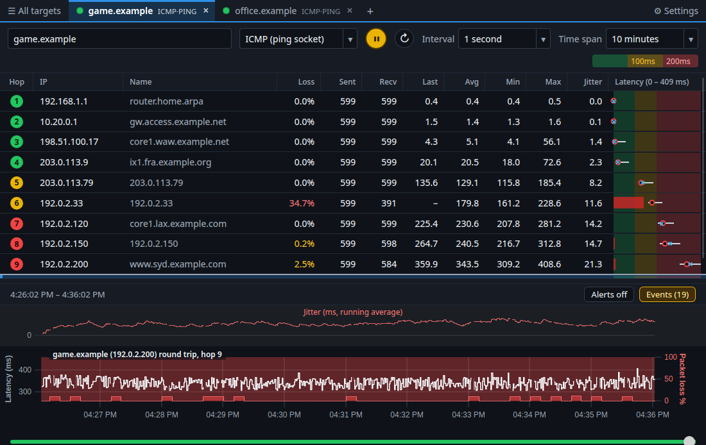
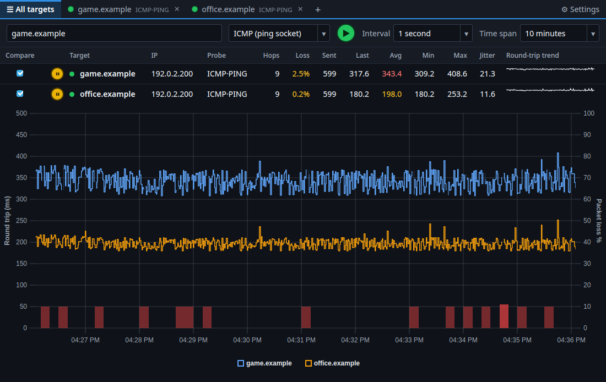
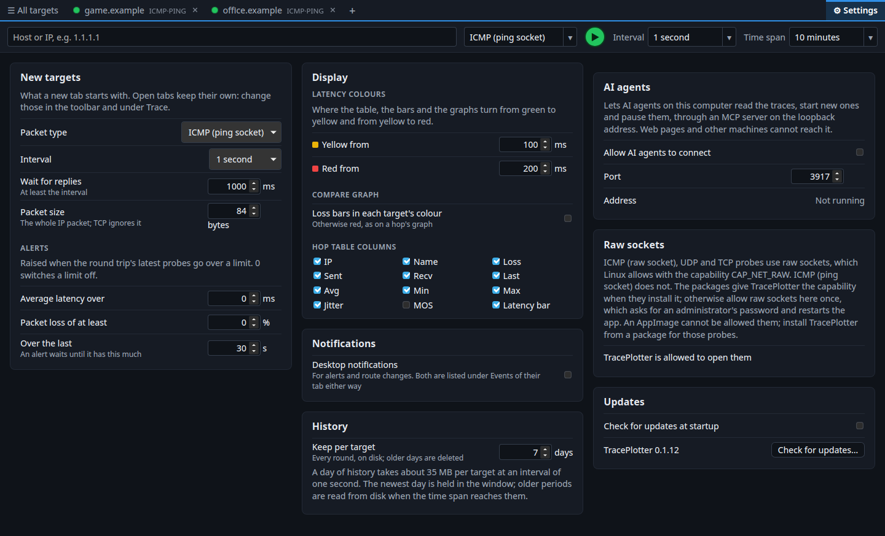

# Legacy GUI layout reference

Captured on 29 October 2026 from TracePlotter 0.1.12 at `146b1b2`, using the
Svelte/Tauri GUI, Linux X11 and WebKitGTK at 100% scale. Both targets are synthetic
`--demo` routes (`game.example` and `office.example`), with a ten-minute view.
No real targets, saved sessions, or network probes were used.

The images come directly from the running webview's renderer. They omit the native
menu bar and operating-system title bar. Filenames give the requested application
window size. The Linux menu takes 26 pixels of that height, so `1100x720` produces
an **1100×694** content image. Each adjacent JSON file records the actual viewport,
colours, font declarations, element positions, sizes and spacing. Use these values
when comparing egui; do not stretch a screenshot to the size in its filename.

The capture used a temporary source copy with scenario and screenshot hooks. It did
not change the application's styles or layout. Temporary hooks and extra screenshot
dependencies are absent from the worktree. The manifest records dimensions and PNG
checksums. Demo values and timestamps change between captures.

## Screenshots

| View | Application window | Rendered content | Reference |
| --- | --- | --- | --- |
| Main trace | 1100×720 | 1100×694 | [PNG](legacy/01-trace-1100x720.png), [measurements](legacy/01-trace-1100x720.json) |
| Main trace, wide | 1440×900 | 1440×874 | [PNG](legacy/02-trace-1440x900.png), [measurements](legacy/02-trace-1440x900.json) |
| Main trace, minimum size | 640×420 | 640×394 | [PNG](legacy/03-trace-640x420.png), [measurements](legacy/03-trace-640x420.json) |
| All targets and comparison | 1100×720 | 1100×694 | [PNG](legacy/04-all-targets-1100x720.png), [measurements](legacy/04-all-targets-1100x720.json) |
| Settings, two columns | 1100×720 | 1100×694 | [PNG](legacy/05-settings-1100x720.png), [measurements](legacy/05-settings-1100x720.json) |
| Settings, three columns | 1440×900 | 1440×874 | [PNG](legacy/06-settings-1440x900.png), [measurements](legacy/06-settings-1440x900.json) |
| Probe settings dialog | 1100×720 | 1100×694 | [PNG](legacy/07-probe-dialog-1100x720.png), [measurements](legacy/07-probe-dialog-1100x720.json) |
| Alert settings dialog | 1100×720 | 1100×694 | [PNG](legacy/08-alert-dialog-1100x720.png), [measurements](legacy/08-alert-dialog-1100x720.json) |
| Multiple selected hops | 1100×720 | 1100×694 | [PNG](legacy/09-multiple-hops-1100x720.png), [measurements](legacy/09-multiple-hops-1100x720.json) |

The [egui layout pass](egui/README.md) contains updated native captures for comparison.

## Layout to preserve in egui

1. Put the tab strip above the target toolbar. Keep All targets on the left, a status
   dot and small protocol label in each target tab, the plus button after targets,
   and Settings at the far right. The selected tab has a blue top stripe, a tinted
   background and bold text.
2. Keep host, protocol, circular pause/start, restart, interval and time span together
   in that toolbar. The latency legend follows them and wraps when necessary. The
   initial egui preview put its time controls below the table and used a separate
   target heading. The layout pass moves those controls back into this toolbar.
3. Use the original table density: approximately 31.8-pixel data rows, 26.8-pixel
   headings, circular coloured hop badges and a bold round-trip row. Use thin
   horizontal rules and selected-row tint rather than alternating row fills. The
   latency column has continuous green/yellow/red zones behind its markers.
4. Put the divider below the table, followed by the period range on the left and
   Alerts/Events on the right. A single graph has its thin red jitter strip above
   the white latency line. Loss bars and the right axis are red. The history slider
   sits below the graphs. The initial egui jitter strip was below its latency plot; the layout pass moves it above.
5. Preserve the comparison table followed by one large comparison graph and its
   bottom legend. Use separate line colours for targets and the configured loss
   colouring.
6. Settings use independent cards flowing into two or three columns, with explanatory
   text and labels on the left and fields on the right. Preserve this structure
   rather than turning all settings into one long form.
7. Match the compact centred dialogs, dark backdrop, 14-pixel interior padding and
   Close button at the lower right. Their contents stay readable over the dimmed
   trace. Test small-window scrolling separately: the legacy minimum-size capture
   gives graphs almost all the available height and clips the hop table.

## Measurements and colours

These are measured on this Linux renderer; Windows font metrics still need capture.

| Element | Measurement |
| --- | --- |
| Body font declaration | `14px/1.4 "Segoe UI Variable", "Segoe UI", system-ui, sans-serif` |
| Tabs | 35.19 px including their lower border |
| Toolbar at 1100 px | 78 px; legend wraps |
| Toolbar at 1440 px | 50 px; one row |
| Toolbar padding | 8 px vertically, 12 px horizontally |
| Hop table divider | 9 px including borders |
| Cell padding | 5 px vertically, 10 px horizontally; hop badges use 6 px horizontally |
| Probe dialog at 1100 px | Approximately 604×205 px |
| Alert dialog at 1100 px | Approximately 537×238 px |

Default table widths in this capture are Hop 52, IP 140, Name 240, Loss 68,
Sent/Recv/Last/Avg/Min/Max/Jitter 64 pixels each. The latency column fills the remaining
space, with a 152-pixel minimum. MOS is hidden by default.

| Token | Value |
| --- | --- |
| Background | `#0f1319` |
| Panel | `#161b24` |
| Lines | `#232a36` |
| Control edges | `#343d4b` |
| Text | `#e6eaf0` |
| Muted text | `#9aa4b2` |
| Accent | `#2f8fe6` |
| Good / warning / bad | `#22c55e` / `#eab308` / `#ef4444` |
| Selected table row | `#173452` |

The initial launch inherited `LC_ALL=C.UTF-8`; uPlot failed while constructing its
number formatter, leaving a Svelte 500 page. Relaunching with `LC_ALL=en_US.UTF-8`
and `LANGUAGE=en_US:en` resolved that capture-session failure. No locale workaround
was added to production code.

These references cover Linux WebKit content. Windows title bars, native menus,
WebView2 font metrics, high DPI and Wayland remain outside this capture set.
