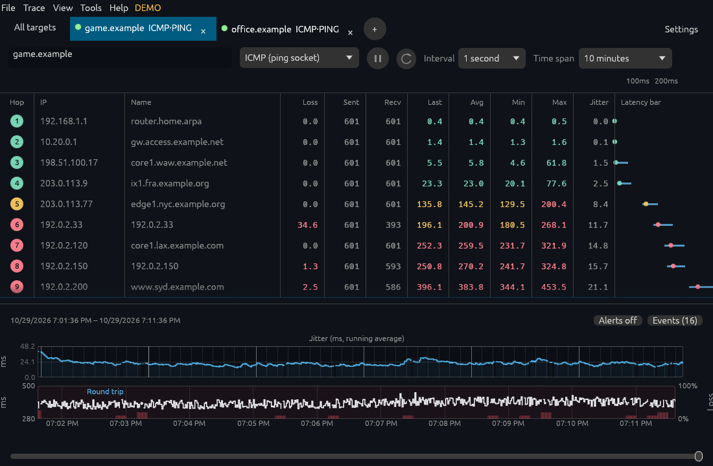

# egui layout pass

Captured on 29 October 2026 after matching the legacy window structure. This pass
changes placement, sizing and spacing. Colours, font rendering and further polish
remain for later work.

[The running demo](trace-demo-1100x720.png) uses the same two synthetic target IDs
and a copy of the legacy demo history. It is the actual native executable on Linux
X11 at 100% scale. Its 1100×720 image includes egui's menu bar. The legacy webview's
1100×694 capture omits the native 26-pixel menu bar, so compare the content below the
native menu rather than stretching either image.

The remaining images use `egui_kittest` to render the same `Window` implementation
with a nine-hop synthetic fixture. Fixture graphs include single-probe spikes and deliberately missing
replies to exercise peak visibility and gap rendering; their numbers are not an exact replay
of the legacy captures. They are layout references, not pixel-equality assertions.

| View | Capture |
| --- | --- |
| Running two-target demo | [1100×720](trace-demo-1100x720.png) |
| Trace fixture | [1100×720](trace.png), [1440×900](trace-wide.png), [640×420](trace-small.png) |
| Hover readout | [1100×720](trace-hover.png) |
| Graph context menu | [1100×720](trace-menu.png) |
| Column context menu | [1440×900](columns-menu.png) |
| All targets | [1100×720](summary.png) |
| Settings | [1100×720](settings.png), [1440×900](settings-wide.png) |
| Probe and alerts dialog | [1100×720](probe-dialog.png) |

The layout keeps the tab strip above the target toolbar, Settings at the right of
the strip, interval and time span in the toolbar, the period/actions strip below
the table, jitter above latency, and the history slider at the bottom. Menus retain
zoom, earlier/later navigation, and return to live. The persistent idle status footer
and separate target heading have been removed. Settings follow the legacy card
columns and the edit form uses a centred modal with a visible Close button.

Widget checks cover normal, wide and minimum windows, toolbar start/pause, the
history slider's visibility, settings columns and the modal's Close button. Hover
readouts float beside the cursor and flip at window edges without shifting the plots.
Context menu checks cover graphs, full hop rows, column headers and target tabs. Linux
rendering and the existing export check pass. Windows, Wayland and high DPI remain
manual acceptance gates.
